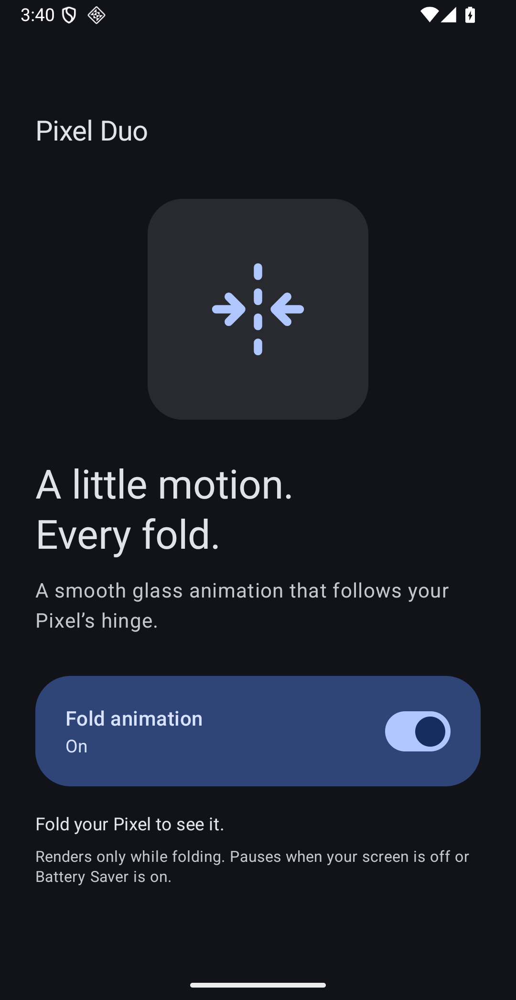

# Pixel Duo

A minimal Pixel Fold adaptation of [Duo Fold Live](https://github.com/joeconsorti/duo-fold-live), based on upstream commit `f31a387438decc101eaf1342e2180817f57d037f`.

Pixel Duo has one on/off switch. Its glass animation follows the public Android hinge sensor on Pixel Fold devices, including Pixel 11 Pro Fold. The interface uses official Material 3 Expressive Compose components, wallpaper colors, system typography, a Lucide fold icon, and an adaptive square launcher icon with three equally spaced center dashes. Android 13 or newer is required.

## Install

[Download the signed PixelDuo 1.0.0 APK](https://github.com/thekozugroup/PixelDuo/releases/download/v1.0.0/PixelDuo-1.0.0.apk). Install it on your phone, open Pixel Duo and turn on Fold animation. Android requires one-time accessibility access under Settings → Accessibility → Downloaded apps → Pixel Duo. Return to Pixel Duo after enabling access.

If Android blocks access after sideloading, open Settings → Apps → Pixel Duo → ⋮ → Allow restricted settings. The app explains this during setup.

For ADB installation, select your phone explicitly when an emulator is also connected:

```sh
adb -s YOUR_PHONE_SERIAL install -r PixelDuo-1.0.0.apk
```

## Animation and battery behavior

The original glass projection is retained with nine shader samples instead of 25. A single temporary screen image is taken at the start of a transition and again if the screen size or rotation changes. It is capped at 960 pixels on its longest edge. Secure windows may refuse capture; these use touch-through live shading instead. The image is a snapshot, so changing video content is not continuously captured during folding.

Rendering uses a half-resolution hardware surface and display vsync, requesting up to 120 Hz only while the overlay exists. Frame-rate-independent smoothing stops scheduling frames once the angle settles. The overlay and image are released after 1.2 seconds without movement or at a fold endpoint. The sensor unregisters when disabled, screen off, Battery Saver on, or system animations off. There is no polling loop, network permission, wake lock, persistent notification, root, Shizuku or vendor wallpaper dependency.

Android controls the physical display handoff. This APK does not force the screen awake, bypass the lock screen, change folding system settings, or change your wallpaper. Physical Pixel 11 Pro Fold timing, frame pacing and energy use require a handset folding test and measurement; emulator verification does not establish those results.

## Build

Use JDK 17, Android SDK 36 and the included Gradle wrapper:

```sh
export JAVA_HOME=/path/to/jdk-17
export ANDROID_HOME=/path/to/android-sdk
./gradlew testReleaseUnitTest lintRelease assembleRelease
```

Official Material 3 Expressive currently requires the experimental public APIs in the pinned `1.5.0-alpha10` library. No design certification is claimed.

The local release signing key and password are in the ignored `signing/` directory. Keep them private and backed up: updates must use the same key. Without a local key, the release build is unsigned. A replacement key cannot update this install.

## Verify

The unit check exercises invalid angles, endpoint clamping, refresh-rate-independent smoothing and all combinations of power/motion policy. `scripts/check_pixel_emulator.py` tests the real service and hinge sensor on an already configured Pixel Fold emulator. It rejects phone serials and checks on/off, capture/overlay creation, touch-through input, idle cleanup, screen-off recovery, reduced motion and Battery Saver. Run with `ANDROID_SERIAL=emulator-5554 python3 scripts/check_pixel_emulator.py`.

See `dist/VERIFICATION.md` for the completed build and device checks. Source and shader notices remain under the upstream MIT license; Lucide uses ISC. Historical upstream documentation remains in `docs/`.


